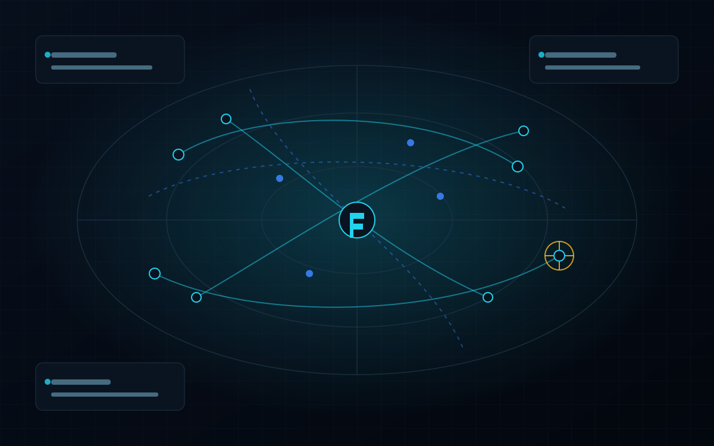

# Signal Threat Intelligence

A threat-intelligence correlation dashboard built by **SYFERON**. It collects indicators from multiple feeds, normalizes conflicting formats and surfaces the relationships between them — so an analyst can follow a campaign from infrastructure to technique without switching tools.



## Run locally

```cmd
set "PATH=C:\Program Files\nodejs;%PATH%"
cd projects\signal-threat-intelligence
npm install
npm run dev
```

Open the URL Vite prints (default `http://localhost:5176`).

## Try it

1. Filter the indicator feed by severity or type.
2. Select an indicator to see its context and related indicators.
3. Click nodes in the relationship graph to pivot between connected indicators.

## Build

```cmd
npm run build
```

## Stack

React 19 · TypeScript · Vite 8 · hand-built SVG graph (no chart dependency). Indicator data is illustrative and runs entirely in the browser.

## Part of the SYFERON portfolio

One of four published projects: Atlas Analytics, Relay API Platform, Sentinel Recon Toolkit and Signal Threat Intelligence. All demos carry the SYFERON watermark.

## License

MIT — see [LICENSE](./LICENSE).
